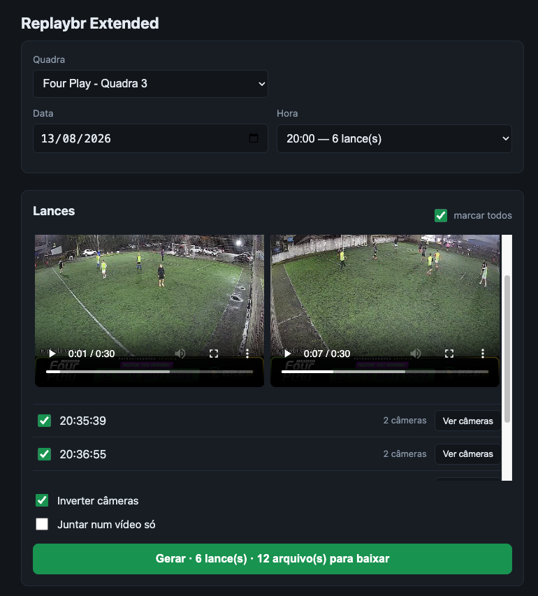

# replaybr-extended

A Chrome extension that downloads the [ReplayBR](https://www.replaybr.com.br/replay?fieldName=four-play-3) replays for a date and hour and makes **one video per play**, with **both cameras side by side**, playing at the same time.

Everything runs in your browser: the search, the downloads, the video rendering (ffmpeg.wasm) and the `.zip`. ReplayBR sits behind Cloudflare's bot check, and the requests go out from your Chrome, which has already passed it.



## Install

1. Download `replaybr-extended-<version>.zip` from the [latest release](https://github.com/joao-salomao/replaybr-extended/releases/latest) and unzip it.
2. In Chrome, open `chrome://extensions` and turn on **Developer mode**.
3. Click **Load unpacked** and pick the unzipped folder.
4. Open `https://www.replaybr.com.br` once in that Chrome, so Cloudflare lets you through.
5. Click the extension's icon: the app opens in a new tab.

To update, unzip the new version over the same folder and click reload (↻) on the extension's card.

### From source

You need [Bun](https://bun.sh). Build the extension and load the `dist/` folder in step 3 above:

```bash
bun install
bun run build
```

After a new `bun run build`, click reload (↻) on the extension's card.

## Use

Pick the court, the date and the hour, tick the plays and click **Gerar** (Generate). Each clip shows up to play and download as soon as it is ready, and at the end you can download them all as a `.zip`. The videos live in the tab's memory: close the tab and the clips are gone.

If the Cloudflare message shows up, open `www.replaybr.com.br` in that same window and try again.

The interface is in Portuguese, like the site.

### Courts

The list comes from the site itself: the extension reads the `humanReadableFieldNameMapping` map from the page's JavaScript and drops the courts the site marks as inactive. If the site changes and that read fails, the extension falls back to the list saved in `src/fields.ts` and says so. The **Quadra** (court) picker has a search box: type part of the name, accents don't matter, then use the arrow keys and Enter. A typed slug (the `fieldName` in the site's URL) shows up as an option, for courts that are not on the list.

### Single camera

Courts with a single camera work too. When an hour mixes one- and two-camera plays, a one-camera play is centered on the same two-column frame, so every clip has the same size.

### Camera order

`camera1` goes on the left and `camera2` on the right. The API's numbering, though, doesn't describe where the cameras physically are: on Four Play - Quadra 3 the sides come out swapped. For those courts, **Inverter câmeras** (swap cameras) is ticked by default (`SWAP_BY_DEFAULT` in `src/fields.ts`).

## Development

```bash
bun run typecheck   # tsc, type checking only
bun test            # pure logic, no network
bun run e2e         # build + the extension in Playwright's Chromium
```

`bun run e2e` needs Playwright's Chromium once: `bunx playwright install chromium`. It loads `dist/` and answers the requests to both ReplayBR hosts with the fixtures in `e2e/`, so it never touches the real site.

```
manifest.config.ts   MV3 manifest (CRXJS)
app.html             the app's page
src/background.ts    the icon opens the app in a tab
src/ui/              interface and ffmpeg.wasm loading
src/api.ts           API client + grouping by hour
src/fields.ts        saved court list
src/fieldsExtract.ts court list read from the site
src/download.ts      parallel downloads into memory, with retry
src/encoder.ts       side-by-side filter + ffmpeg.wasm
src/mp4.ts           dimensions from the MP4 box tree
src/render.ts        download → render pipeline, several plays in parallel
src/zip.ts           the .zip of every clip
e2e/                 end-to-end test and fixtures
```

## Releasing a version

1. Bump `version` in `package.json` (the manifest reads the same version) and merge into `main`.
2. In **Actions > Release > Run workflow**, run it on `main`.

The workflow runs the typecheck, the unit tests and the e2e, builds `dist/`, publishes the `v<version>` release with the `.zip` attached, and stops if that tag already exists.

CI and the release install Bun at the version in the `BUN_VERSION` repository variable (Settings > Secrets and variables > Actions > Variables). Keep it the same as your local version (`bun --version`).
